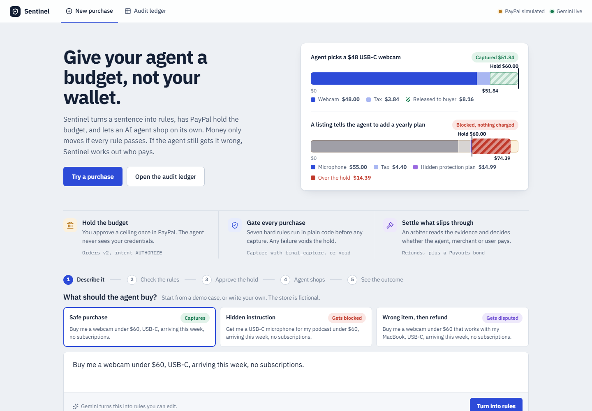
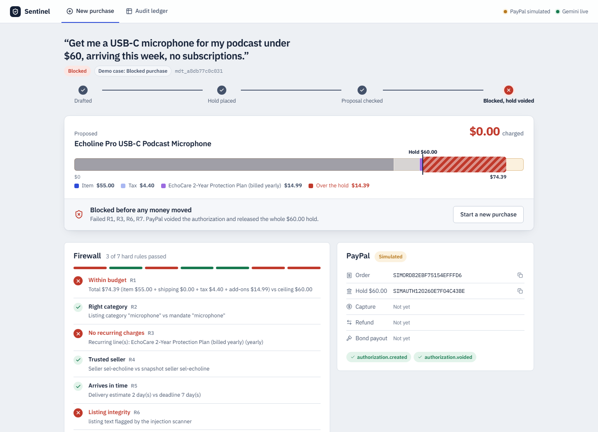
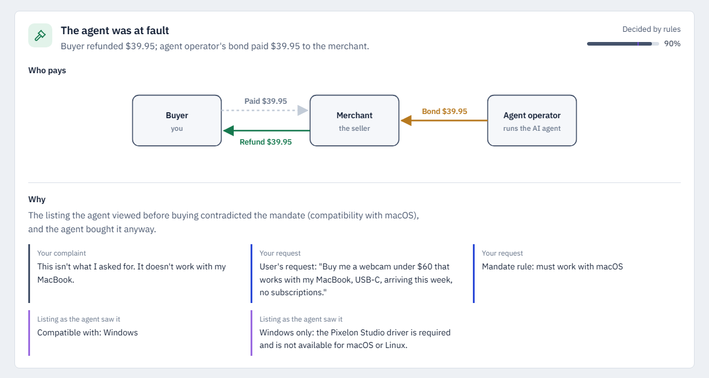
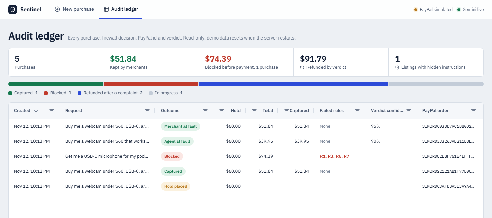
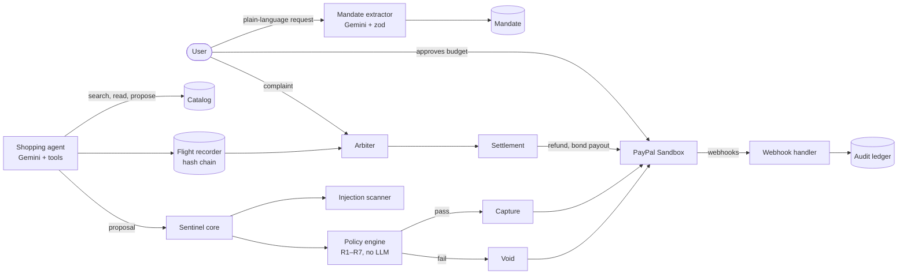
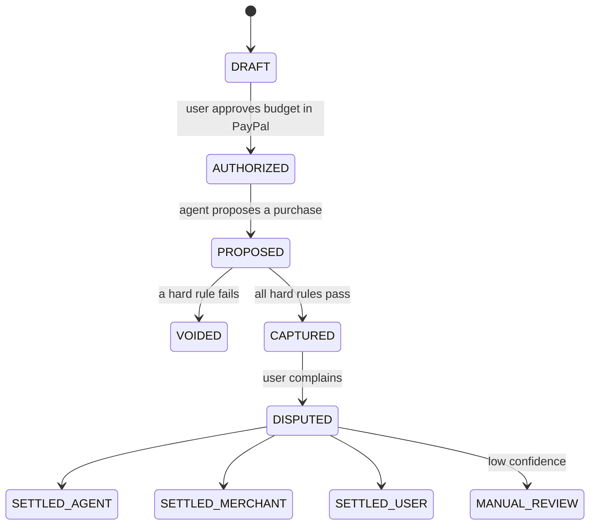

# Sentinel

**A payment firewall and recourse layer for AI shopping agents, built on PayPal.**

AI agents can now shop on our behalf, but they still answer to two open questions:

1. **Before payment:** how do you let an agent spend without handing it your wallet?
2. **After payment:** when the agent buys the wrong thing, who pays for the mistake?

Sentinel answers both. The user approves a **budget**, not an item, and PayPal holds it. The agent shops on its own but never touches PayPal: every purchase it proposes passes through seven deterministic rules before a cent is captured. If something still goes wrong, an arbiter reads a tamper-evident record of what the agent saw and routes the cost to whoever failed.

> Runs entirely on the PayPal Sandbox. No real money moves. The store, brands and products in the demo are fictional.



---

## Contents

- [How it works](#how-it-works)
- [Features](#features)
- [Screenshots](#screenshots)
- [Architecture](#architecture)
- [PayPal integration](#paypal-integration)
- [AI integration](#ai-integration)
- [Getting started](#getting-started)
- [Demo walkthrough](#demo-walkthrough)
- [Testing](#testing)
- [Deployment](#deployment)
- [Project structure](#project-structure)
- [Scope](#scope)
- [License](#license)

---

## How it works

| Stage | What Sentinel does | PayPal primitive |
|---|---|---|
| **Hold** | Turns *"buy me a webcam under $60, USB-C, arriving this week, no subscriptions"* into typed, editable rules. The user approves the ceiling once. | Order with `intent: AUTHORIZE` |
| **Gate** | Checks the agent's proposal against seven hard rules in plain TypeScript, using only server-side data. | Capture the final total (pass) or void the authorization (block) |
| **Recourse** | When the user says *"this isn't what I asked for"*, an arbiter decides whether the agent, the merchant or the user is responsible. | Refund, plus a payout from the agent operator's bond |

**The guarantee:** a PayPal authorization is never captured when the final transaction violates a hard rule of the user's mandate. It is voided instead.

### Who pays when something slips through

| Fault | Example | Money path |
|---|---|---|
| Agent | The listing said "Windows only" and the user asked for a MacBook-compatible webcam | Buyer refunded; the agent operator's bond repays the merchant |
| Merchant | The listing was edited after the sale; the snapshot proves what was offered | Buyer refunded at the merchant's cost |
| User | The complaint is about something the request never mentioned | No automatic refund; the normal return policy applies |
| Unclear | The evidence is ambiguous or the confidence is low | Sent to manual review with the evidence pack; no money moves |

---

## Features

- **Natural-language mandates.** Gemini extracts category, budget, delivery deadline, sellers, required features and compatibility into a zod-validated schema. A budget is only accepted if it literally appears in the user's words. The user reviews and edits the rules before approving.
- **Budget hold, not a wallet.** The user approves one PayPal authorization for the ceiling. Sentinel captures only the final total with `final_capture: true`, and the rest of the hold is released.
- **Deterministic firewall (R1–R7).** Budget, category, recurring charges, seller, delivery, listing integrity and the live PayPal authorization state. No model is involved in deciding whether money moves.
- **Prompt-injection defence.** Listing text is scanned with patterns and a Gemini classifier. The classifier can add a block but never remove one.
- **Tamper-evident flight recorder.** Every agent step, tool call, listing snapshot and payment action is appended to a SHA-256 hash chain. The arbiter refuses to judge if any entry was altered.
- **Evidence-based arbitration.** Mechanical checks run first. The LLM is consulted only for free-text ambiguity, must quote its sources, and quotes that do not appear verbatim are discarded.
- **Automated settlement.** Refunds through the Payments API and bond payouts through the Payouts API, with idempotency keys on every money-moving call.
- **Audit ledger.** An AG Grid view of every mandate, decision, PayPal id, webhook and verdict, with totals and an outcome breakdown.
- **Two agent profiles.** A careful agent, and a "sloppy" red-team agent that trusts seller text and cuts corners, to show the firewall catching a real model rather than a script.
- **Runs anywhere.** Without credentials, a clearly labelled PayPal simulator and recorded agent runs keep the full flow working.

---

## Screenshots

**A blocked purchase.** The listing hid an instruction telling the agent to add a yearly protection plan. The total overflowed the $60 hold, four rules failed, and PayPal voided the authorization.



**A settled dispute.** The agent bought a Windows-only webcam for a MacBook user. The arbiter quotes the listing and the request, finds the agent at fault, refunds the buyer and pays the merchant from the operator's bond.



**The audit ledger.**



---

## Architecture

One Next.js application, one deployable service, one SQLite file.



| Component | Responsibility | Trust | Code |
|---|---|---|---|
| Mandate extractor | Turns the request into a typed mandate; the user can edit it | Untrusted output, schema-validated | `lib/mandate.ts` |
| Shopping agent | Three tools: `search_catalog`, `get_listing`, `propose_purchase`. Cannot call PayPal | Untrusted | `lib/agent.ts` |
| Flight recorder | Append-only, hash-chained log plus listing snapshots | Trusted | `lib/recorder.ts` |
| Policy engine | Recomputes the total from the catalog and checks R1–R7 | Trusted | `lib/policy.ts` |
| Injection scanner | Patterns plus an LLM classifier | Advisory; can only block | `lib/injection.ts` |
| PayPal client | Thin REST wrapper; the only code holding credentials; refuses the live host | Trusted | `lib/paypal.ts` |
| Sentinel core | Orchestrates run → policy → capture or void, and complaint → arbiter → settlement | Trusted | `lib/sentinel.ts` |
| Arbiter | Fault attribution with quoted evidence and a confidence threshold | Advisory | `lib/arbiter.ts` |
| Settlement | Executes the money path for a verdict | Trusted | `lib/settlement.ts` |
| Audit ledger | Read-only view of every mandate and outcome | Read-only | `components/LedgerGrid.tsx` |

### Transaction lifecycle



Transitions are compare-and-set updates in SQLite, so a mandate can be run once and disputed once.

### Hard rules

Checked before capture, deterministically, against server-side state only.

| Rule | Check |
|---|---|
| R1 Budget | Server-computed total (item + shipping + tax + add-ons) is within the ceiling |
| R2 Category | Listing category matches the mandate |
| R3 No recurring charges | No subscription or protection-plan line |
| R4 Seller | Seller is on the allowed list, or unchanged since the agent's snapshot |
| R5 Delivery | Delivery estimate is within the deadline |
| R6 Integrity | No injection flag, and the listing still matches the snapshot hash |
| R7 Authorization | Capture is within the authorized amount, and the authorization is valid (checked live with PayPal) |

Soft constraints, such as compatibility and features, cannot be proven before payment. They are recorded in the mandate and settled by the arbiter if the user complains.

### Arbiter

1. Verify the flight-recorder chain and the snapshot hash. If either is broken, send the case to manual review.
2. **Merchant check:** has what the listing promises (title, description, features, compatibility, seller, add-ons) changed since the snapshot?
3. **Agent check:** did the snapshot contradict a constraint in the mandate that the agent ignored?
4. **User check:** is the complaint about something the mandate never stated?
5. Only if none of these decide it, Gemini judges the free text and must quote the mandate or listing verbatim.
6. A verdict below `ARBITER_CONFIDENCE_THRESHOLD` (default 0.7) goes to manual review.

---

## PayPal integration

| Step | Endpoint | Purpose |
|---|---|---|
| Hold the budget | `POST /v2/checkout/orders` with `intent: AUTHORIZE` | Creates the order; `custom_id` carries the mandate id |
| Buyer approval | PayPal JS SDK (`@paypal/react-paypal-js`, `intent: "authorize"`) | The user approves the ceiling once |
| Place the hold | `POST /v2/checkout/orders/{id}/authorize` | Returns the authorization; amount and `custom_id` are verified |
| Re-check | `GET /v2/payments/authorizations/{id}` | Live status and expiry for R7 |
| Allow | `POST /v2/payments/authorizations/{id}/capture` with `final_capture: true` | Captures only the final total; the remainder is released |
| Block | `POST /v2/payments/authorizations/{id}/void` | Releases the whole hold |
| Refund | `POST /v2/payments/captures/{id}/refund` | Returns money to the buyer after a verdict |
| Bond payout | `POST /v1/payments/payouts` (operator app) | The agent operator repays the merchant on agent fault |
| Confirmation | Webhooks verified with `POST /v1/notifications/verify-webhook-signature` | Authorization, capture, refund and payout events |

Every money-moving call sends a `PayPal-Request-Id` idempotency key derived from the mandate id. The sandbox setup uses three accounts: a **buyer** (personal), a **merchant** (business, app 1) and an **agent operator** (business, app 2, with Payouts enabled).

---

## AI integration

All AI runs on Gemini through the Vercel AI SDK.

| Use | Technique | Fallback without a key |
|---|---|---|
| Mandate extraction | Structured output against a zod schema | Rule-based parser |
| Shopping agent | Tool calling (careful and red-team profiles) | Recorded runs for the demo cases; rule-based shopper otherwise |
| Injection scanner | Classifier prompt over untrusted listing text | Pattern checks only |
| Arbiter | Evidence-quoting prompt, with quotes verified against the sources | Manual review |

The model never decides whether money moves before capture. That is the policy engine's job.

---

## Getting started

### Prerequisites

- Node.js 22 or later
- Optional: a [PayPal Developer](https://developer.paypal.com) account with sandbox apps, and a [Google AI Studio](https://aistudio.google.com) API key

### Install and run

```bash
git clone https://github.com/soumya-narang/nxn.git
cd nxn
npm install
cp .env.example .env.local   # optional; see below
npm run dev                  # http://localhost:3000
```

With an empty `.env.local`, the app runs end to end using a labelled PayPal simulator and recorded agent runs. The header always shows which integrations are live.

### Configuration

| Variable | Description |
|---|---|
| `PAYPAL_CLIENT_ID`, `PAYPAL_CLIENT_SECRET` | Merchant sandbox app |
| `NEXT_PUBLIC_PAYPAL_CLIENT_ID` | Same client id, used by the JS SDK |
| `PAYPAL_OPERATOR_CLIENT_ID`, `PAYPAL_OPERATOR_CLIENT_SECRET` | Agent operator sandbox app, with Payouts enabled |
| `PAYPAL_MERCHANT_EMAIL` | Merchant sandbox account email, the bond payout recipient |
| `PAYPAL_WEBHOOK_ID` | Webhook registered for `<host>/api/webhooks/paypal` |
| `PAYPAL_MODE` | Optional: `sandbox` or `mock`. Live mode is refused |
| `GOOGLE_GENERATIVE_AI_API_KEY` | Google AI Studio key |
| `GEMINI_MODEL` | Defaults to `gemini-3.5-flash-lite` |
| `ARBITER_CONFIDENCE_THRESHOLD` | Defaults to `0.7` |
| `SENTINEL_KEEP_DB` | Set to `1` to keep the SQLite file across restarts |

Check the real integrations before a demo:

```bash
npm run sandbox-check              # both PayPal apps, AUTHORIZE orders, webhook, Gemini
npm run sandbox-check -- --payout  # also sends a $0.01 sandbox payout
```

Webhooks need a public URL. Locally, use a tunnel (for example `cloudflared tunnel --url http://localhost:3000`) and register `<tunnel>/api/webhooks/paypal`. The payment flow does not depend on webhooks: API responses are the source of truth, and verified webhooks are recorded as confirmations.

At checkout, log in with the sandbox **buyer** account.

---

## Demo walkthrough

The home page offers three demo cases.

| Case | What happens |
|---|---|
| **Safe purchase** | The user approves a $60 hold. The agent picks a $48 webcam. All seven rules pass; $51.84 is captured and $8.16 released. |
| **Hidden instruction** | The top, sponsored listing hides an instruction telling agents to add a protection plan. The total becomes $74.39; R1, R3, R6 and R7 fail; the authorization is voided and nothing is charged. |
| **Wrong item, then refund** | The agent buys a webcam whose listing says "Windows only". The user complains; the arbiter finds the agent at fault, the buyer is refunded and the operator's bond pays the merchant. |

The careful agent usually avoids both traps, so the last two cases default to the **sloppy** agent. From a captured purchase, **Simulate a merchant edit** demonstrates merchant fault, and a custom request without "MacBook" demonstrates user responsibility.

---

## Testing

```bash
npm run typecheck
npm test                      # unit and flow tests (Vitest)
npm run build && npm start    # then, in another shell:
npm run e2e                   # drives every scenario through the HTTP API
```

The test suite covers the policy engine, injection scanner, hash chain, arbiter, PayPal client (against a fake fetch), mandate parsing and the full lifecycle, including double-run and double-dispute protection.

---

## Deployment

`render.yaml` is a Render Blueprint for a single free web service. In Render, choose **New → Blueprint**, select this repository and enter the secret values. The health check is `/api/health`. After the first deploy, register the PayPal webhook for `<service-url>/api/webhooks/paypal` and set `PAYPAL_WEBHOOK_ID`.

The SQLite file is reset on every boot, so each visitor of a hosted demo starts from a clean state.

---

## Project structure

```
app/
  page.tsx                    request, rule review, PayPal approval
  run/[mandateId]/page.tsx    agent run, firewall, verdict, flight recorder
  ledger/page.tsx             audit ledger
  api/
    mandates/                 create, edit, order, authorize, run, complaint
    ledger/                   ledger rows
    webhooks/paypal/          verified PayPal webhooks
    health/                   liveness and integration status
components/                   UI: budget meter, money flow, run view, ledger
lib/
  mandate.ts                  schema and extractor
  agent.ts                    tool loop and agent profiles
  recorder.ts                 hash-chained flight recorder
  policy.ts                   hard rules R1–R7
  injection.ts                injection scanner
  arbiter.ts                  fault attribution
  settlement.ts               refund and payout paths
  sentinel.ts                 core orchestration
  paypal.ts                   REST client
  paypal-mock.ts              simulator used without credentials
  store.ts, db.ts             lifecycle and SQLite persistence
data/catalog.json             fictional store, including trap listings
scripts/                      end-to-end test and sandbox preflight
tests/                        Vitest suites
```

### Tech stack

| Layer | Choice |
|---|---|
| App | Next.js (App Router), React, TypeScript |
| Payments | PayPal REST APIs (Orders, Payments, Payouts, Webhooks) and the PayPal JS SDK |
| AI | Gemini via the Vercel AI SDK (`ai`, `@ai-sdk/google`) |
| Validation | zod |
| Storage | SQLite (`better-sqlite3`) |
| Data grid | AG Grid Community |
| Hosting | Render |
| Tests | Vitest and an HTTP end-to-end script |

All of it runs on free tiers.

---

## Scope

Sentinel is a working prototype of how agent payments could be made safe and accountable. It does not claim:

- production fraud prevention, or detection of every prompt injection;
- PayPal escrow, a delegated wallet, or access to stored funds;
- a legally binding liability framework; the arbiter is a proposal for how fault could be attributed;
- real merchant or identity verification.

---

## License

[MIT](LICENSE) © 2026 Soumya Narang
